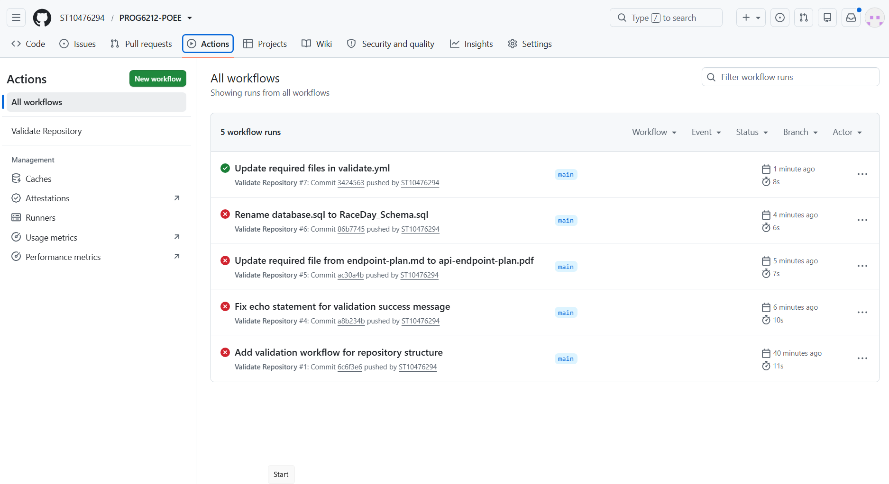

# RaceDay

RaceDay is a web-based event management system for the South African road running, walking and cycling community. Organisers manage events and results, and Participants enter events and track their performance.

The system has three parts in one repository:

| Part | Contents |
|---|---|
| Part 1: Planning | ERD, API endpoint plan and SQL script in `docs/` |
| Part 2: REST API | `RaceDay.Api` and `RaceDay.Api.Tests` |
| Part 3: Web application | `RaceDay.Mvc`, Azure Blob Storage through the API, and Docker |

## Roles

- **Organiser:** creates, edits and deletes events, manages categories, views enrolments for their own events, and captures and publishes results.
- **Participant:** creates an account, browses events, enters an event by selecting a category, views their enrolments, tracks their results, and manages their profile and picture.

Role and ownership rules are enforced by the API. The website's menus and page guards reflect them, but do not replace them.

## Technologies

C# and .NET 8, ASP.NET Core Web API and MVC, Entity Framework Core 8 (Code-First) with SQL Server, BCrypt, server-side sessions, Swagger, Azure Blob Storage, Bootstrap 5, xUnit, Docker and GitHub Actions.

## Project structure

```text
RaceDay.Api/          REST API: controllers, models, EF Core data, migrations, image storage
RaceDay.Api.Tests/    API tests using real session handling and an in-memory SQLite database
RaceDay.Mvc/          MVC website: controllers, views, API client, Dockerfile
docs/                 ERD, endpoint plan, SQL script and plan changes
.github/workflows/    CI: repository validation, build, tests and Docker image build
```

The MVC project has no database or Azure access. `RaceDay.Mvc/Services/RaceDayApiClient.cs` is the only class that calls the API.

## Prerequisites (Windows)

The steps below are for Windows 10 or 11, including a Windows virtual machine. Run every command in **PowerShell** from the repository's root folder. Instructions for other systems are in [Running on macOS or Linux](#running-on-macos-or-linux).

| Software | Needed for | Notes |
|---|---|---|
| [.NET 8 SDK](https://dotnet.microsoft.com/download/dotnet/8.0) | Building and running everything | A newer SDK alone is not enough, because the ASP.NET Core 8 runtime is required. |
| [Visual Studio 2022](https://visualstudio.microsoft.com/) | SQL Server LocalDB, and optionally running the projects | Choose the **ASP.NET and web development** workload, and confirm that **SQL Server Express LocalDB** is ticked under **Individual components**. |
| [SSMS](https://learn.microsoft.com/sql/ssms/download-sql-server-management-studio-ssms) | Viewing data and running the SQL script | Connect to the server `(localdb)\MSSQLLocalDB` with Windows Authentication. |
| [Git](https://git-scm.com/download/win) | Getting the code | |
| [Docker Desktop](https://www.docker.com/products/docker-desktop/) | Running the website in a container | Not needed to run the website directly. |
| Azure Storage account | Image uploads | Everything else works without it. |

**Using a virtual machine:** Docker Desktop needs virtualization inside the VM, so turn on **nested virtualization** in your VM software's processor settings while the VM is shut down, and give the VM at least 8 GB of memory.

## Setup (Windows)

### 1. Get the code

```powershell
git clone https://github.com/ST10476294/PROG6212-POEE.git
```

```powershell
cd PROG6212-POEE
```

### 2. Configure the API

The API already uses LocalDB by default, so it needs no database settings on Windows.

To enable image uploads, store your Azure connection string as a user secret. This keeps it out of source control. Use PowerShell for these commands, and keep the single quotes.

```powershell
dotnet user-secrets init --project RaceDay.Api
```

```powershell
dotnet user-secrets set 'AzureStorage:ConnectionString' 'YOUR_AZURE_STORAGE_CONNECTION_STRING' --project RaceDay.Api
```

| Setting | Purpose | Default |
|---|---|---|
| `ConnectionStrings:RaceDayDB` | SQL Server connection | LocalDB |
| `AzureStorage:ConnectionString` | Azure Storage account | None; uploads return a friendly error |
| `AzureStorage:ContainerName` | Blob container, created automatically | `raceday-images` |
| `Registration:OrganiserCode` | Code needed to register as an Organiser | `RACEDAY-DEV-ORGANISER` in Development only |
| `SeedDemoData` | Adds demo accounts and events to an empty database | `false` |

In the Azure Portal, set **Allow Blob anonymous access** to **Enabled** under **Settings > Configuration** so browsers can display uploaded images. To find the connection string, open **Security + networking > Access keys** and select **Show keys**. Keep storage account key access enabled, because the connection string depends on it.

### 3. Create the database

Use **one** of these methods. Do not use both on the same database.

**Code-First migrations (recommended):**

```powershell
dotnet tool restore
```

```powershell
dotnet ef database update --project RaceDay.Api
```

**SQL script:** open `docs/RaceDay_Schema.sql` in SSMS, connect to `(localdb)\MSSQLLocalDB` and run it. It drops and recreates the RaceDay tables, so never run it against data you want to keep.

### 4. Run the API and website

Open two PowerShell windows in the repository's root folder. The website must call the API's `http` address, so use the `http` profile.

**Window 1: the API.** To add demo data to an empty database created with migrations, run this command first. Do not use this setting with a database created by the SQL script, which already contains seed data.

```powershell
$env:SeedDemoData = "true"
```

Then start the API:

```powershell
dotnet run --project RaceDay.Api --launch-profile http
```

**Window 2: the website.**

```powershell
dotnet run --project RaceDay.Mvc
```

Open <http://localhost:5020>. Swagger is at <http://localhost:5298/swagger> in Development.

### Run from Visual Studio

1. Open `RaceDay.Api.sln`.
2. Right-click the solution and choose **Configure Startup Projects**.
3. Choose **Multiple startup projects**, then set `RaceDay.Api` and `RaceDay.Mvc` to **Start**.
4. Select the `http` launch profile for `RaceDay.Api`. The `https` profile is not intended for use with the website.
5. Press **F5**.

### Demo accounts

These exist after using either `SeedDemoData` or the SQL script. They are for demonstration only. The password for all of them is `RaceDay!2026`.

| Role | Email |
|---|---|
| Organiser | `thabo.nkosi@raceday.co.za` |
| Organiser | `lerato.dube@raceday.co.za` |
| Participant | `sipho.mokoena@example.com` |
| Participant | `amahle.zulu@example.com` |

## Run with Docker

Start Docker Desktop and keep the API running on your computer. Stop any copy of the website that is already running, then build the website image:

```powershell
docker build --tag raceday-mvc RaceDay.Mvc
```

Start the website with this single command:

```powershell
docker run --rm -p 8080:8080 -e ApiBaseUrl=http://host.docker.internal:5298 raceday-mvc
```

Open <http://localhost:8080>. Press **Ctrl+C** in that window to stop it.

`ApiBaseUrl` is the only setting the container needs, because all data and files go through the API.

## Troubleshooting on Windows

| Problem | Solution |
|---|---|
| `dotnet ef` is not found | Run `dotnet tool restore` first, from the repository's root folder. |
| The `Microsoft.AspNetCore.App` version 8 framework was not found | Install the .NET 8 SDK. |
| The API cannot connect to LocalDB | Run `sqllocaldb start MSSQLLocalDB`. If `sqllocaldb` is not found, add **SQL Server Express LocalDB** in the Visual Studio Installer. |
| Docker Desktop reports a virtualization or WSL error | Turn on nested virtualization for the VM, restart it, then run `wsl --install` and restart again. |
| The website in Docker says RaceDay is temporarily unavailable | Confirm the API is running. If it is, restart it with the command below and allow it through Windows Firewall if asked. |
| Uploads say that image storage is not configured | Set `AzureStorage:ConnectionString`, then restart the API. |

If the container cannot reach the API, restart the API so that it listens on all network addresses:

```powershell
dotnet run --project RaceDay.Api --launch-profile http -- --urls http://0.0.0.0:5298
```

## Running on macOS or Linux

Install the [.NET 8 SDK](https://dotnet.microsoft.com/download/dotnet/8.0) and Docker. LocalDB is Windows-only, so run SQL Server in Docker, choosing your own strong password:

```bash
docker run -d --name raceday-sql -e ACCEPT_EULA=Y -e MSSQL_SA_PASSWORD='YOUR_STRONG_PASSWORD' -p 1433:1433 mcr.microsoft.com/mssql/server:2022-latest
```

Store the connection string as a user secret:

```bash
dotnet user-secrets init --project RaceDay.Api
```

```bash
dotnet user-secrets set 'ConnectionStrings:RaceDayDB' 'Server=localhost,1433;Database=RaceDayDB;User Id=sa;Password=YOUR_STRONG_PASSWORD;TrustServerCertificate=True' --project RaceDay.Api
```

The other steps match the Windows steps, with one difference. Set demo data on the same line as the command:

```bash
SeedDemoData=true dotnet run --project RaceDay.Api --launch-profile http
```

On Linux, add `--add-host=host.docker.internal:host-gateway` to the `docker run` command.

## Authentication

1. Registering as an Organiser requires the organiser code. Participants do not need one.
2. Logging in stores the user ID and role in a server-side API session. Passwords are stored only as BCrypt hashes.
3. The website stores the same details in its own session, along with the API session cookie, which never reaches the browser.
4. Logging out ends both sessions. Sessions expire after 30 minutes of inactivity, and are held in memory, so restarting an app ends them.

To use Swagger, call `POST /api/auth/login` first. The browser then sends the session cookie automatically.

## API overview

All 19 Part 1 operations are implemented, plus additions needed for later requirements, giving 24 operations in Swagger. Every difference from the plan is explained in [docs/plan-changes.md](docs/plan-changes.md).

## Run the tests

```bash
dotnet test RaceDay.Api.sln
```

The tests send real HTTP requests through the API, using isolated in-memory SQLite databases and a fake image store, so they need no SQL Server or Azure account.

## CI/CD

`.github/workflows/validate.yml` validates the repository structure. `.github/workflows/part2.yml` restores, builds the API, tests and MVC projects, runs all tests, and builds the Docker image on every push and pull request.

### Green build screenshots

Part 1:



Part 2:


Part 3: **OUTSTANDING - add a screenshot of the green Part 3 run here.**

## Video presentations

- Part 1: https://www.youtube.com/shorts/ibWM3m3GF6c
- Part 2: https://youtu.be/6HNs7CuFW24?si=bb1tU_o6eJtcxD9F
- Part 3: **OUTSTANDING - add the unlisted YouTube link here.**

## AI usage disclosure

OpenAI Codex assisted with requirements analysis, implementation, test creation and documentation in Part 2. Anthropic Claude assisted with auditing the project against the rubric, implementing Part 3 and the related API changes, tests, the SQL script corrections and documentation. **OUTSTANDING - before submitting, confirm this describes your own use of AI and add how you reviewed and tested the work.**
